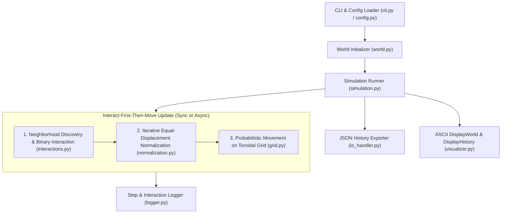

# DRIMA Implementation Plan

## Goal Description

Implement **DRIMA** (*Dynamics of Randomly Interacting Moving Agents*) in **Python 3.9.6** (using the Python standard library only) strictly following the specification in [DRIMA: A Minimal System for Probing the Dynamics of Change in a Reactive Multi-Agent Setting.tex](file:///Users/cauesantana/Desktop/DRIMA/docs/DRIMA:%20A%20Minimal%20System%20for%20Probing%20the%20Dynamics%20of%20Change%20in%20a%20Reactive%20Multi-Agent%20Setting.tex) and the requirements in [INSTRUCTIONS.md](file:///Users/cauesantana/Desktop/DRIMA/INSTRUCTIONS.md).

The system provides:
1. A complete cellular multi-agent simulation engine modeling reactive **D-agents** (deterministic) and **R-agents** (random) on a 2D periodic (toroidal) grid following an **interact-first-then-move** cycle.
2. Full configurability of all initial agent and world variables via both **JSON configuration files** and **CLI flags/arguments** (with CLI flags overriding JSON config values).
3. Comprehensive event/step logging (`logging` module + detailed interaction/movement logs) and generation of a final **JSON history file** containing every world snapshot and metadata.
4. Terminal/ASCII visualization equivalents of `DisplayWorld` and `DisplayHistory`.
5. Clean PEP 8 architecture, full docstrings with practical usage examples and project overview, and a `unittest` test suite covering every feature and edge case.

---

## Architecture & Mathematical Specification Summary



### Core Model Rules (from Section 2 & Section 3 of the Paper)

1. **Grid & Coordinates ([docs/DRIMA...tex](file:///Users/cauesantana/Desktop/DRIMA/docs/DRIMA:%20A%20Minimal%20System%20for%20Probing%20the%20Dynamics%20of%20Change%20in%20a%20Reactive%20Multi-Agent%20Setting.tex#L66-L67), [L135](file:///Users/cauesantana/Desktop/DRIMA/docs/DRIMA:%20A%20Minimal%20System%20for%20Probing%20the%20Dynamics%20of%20Change%20in%20a%20Reactive%20Multi-Agent%20Setting.tex#L135)):**
   - Discrete 2D grid of size $\{X_{\max}, Y_{\max}\}$ with **periodic boundary conditions** (edges wrap around opposite edges). Coordinates are 1-indexed $\{x, y\}$ where $1 \le x \le X_{\max}$ and $1 \le y \le Y_{\max}$ to match the paper's representation (`{2, 2}`, `{5, 3}`, `{4, 6}` in a `{5, 10}` grid).
   - 8 compass directions + no-movement ($X$) in exact index order:
     $$\text{Movement Pattern} = \{P_E, P_{NE}, P_N, P_{NW}, P_W, P_{SW}, P_S, P_{SE}, X\}$$
   - Coordinate deltas $(\Delta x, \Delta y)$ wrapped onto $[1, X_{\max}] \times [1, Y_{\max}]$:
     - `E`: $(+1, 0)$, `NE`: $(+1, +1)$, `N`: $(0, +1)$, `NW`: $(-1, +1)$, `W`: $(-1, 0)$, `SW`: $(-1, -1)$, `S`: $(0, -1)$, `SE`: $(+1, -1)$, `X`: $(0, 0)$.

2. **Agent & World Representation ([docs/DRIMA...tex](file:///Users/cauesantana/Desktop/DRIMA/docs/DRIMA:%20A%20Minimal%20System%20for%20Probing%20the%20Dynamics%20of%20Change%20in%20a%20Reactive%20Multi-Agent%20Setting.tex#L124-L173)):**
   - **Agent:** `{identity, position}` where:
     - `identity` = `{name, movement_pattern, list_of_properties}`
     - `name`: `"D01"`, `"R01"`, etc. (agent type `'D'` or `'R'` + zero-padded unique index)
     - `movement_pattern`: 9 floats summing to $1.0$: $[P_E, P_{NE}, P_N, P_{NW}, P_W, P_{SW}, P_S, P_{SE}, X]$
     - `list_of_properties`: includes `transition_potential_pattern` (9 values; initialized to `0` everywhere except `1000` at the movement direction of a D-agent, or user-configurable) plus optional custom properties (`susceptibility`, `influence_potential`, etc.)
     - `position`: `[x, y]`
   - **World:** `{list_of_agents, grid_size, types_of_interaction, world_mobility}`
   - **World Mobility (`F` or `P`):**
     - Full (`F`): $X$ (index 8, no-move probability) is initialized to `0.0` and kept at `0.0` throughout all iterations. R-agents initialize uniformly with $1/8 = 0.125$ in the 8 compass directions and $0$ in $X$. D-agents have $1.0$ in one active direction (from the 8 compass directions) and $0.0$ elsewhere.
     - Partial (`P`): $X$ is treated like any other direction field. R-agents initialize uniformly with $1/9 \approx 0.1111\dots$ across all 9 fields. D-agents can have $1.0$ in any of the 9 fields (including $X$).

3. **Neighborhood & Range of Action $R$ ([docs/DRIMA...tex](file:///Users/cauesantana/Desktop/DRIMA/docs/DRIMA:%20A%20Minimal%20System%20for%20Probing%20the%20Dynamics%20of%20Change%20in%20a%20Reactive%20Multi-Agent%20Setting.tex#L97)):**
   - Isotropic **Moore neighborhood** of radius $R \ge 0$ under periodic boundary conditions:
     $$\text{dist}_{\text{Moore}}((x_1, y_1), (x_2, y_2)) = \max\left(\min(|x_1 - x_2|, X_{\max} - |x_1 - x_2|), \min(|y_1 - y_2|, Y_{\max} - |y_1 - y_2|)\right) \le R$$
   - If $R = 0$, only agents sharing the exact same grid cell $(x_1 = x_2, y_1 = y_2)$ are within range.
   - Usually $R = 1$ (same cell or any of the 8 contiguous neighboring cells).

4. **Interaction Types ([docs/DRIMA...tex](file:///Users/cauesantana/Desktop/DRIMA/docs/DRIMA:%20A%20Minimal%20System%20for%20Probing%20the%20Dynamics%20of%20Change%20in%20a%20Reactive%20Multi-Agent%20Setting.tex#L139-L141)):**
   - Allowed specifications: subset of `{"dd", "DD", "rr", "RR", "dR", "Rd"}` (plus optional `"Dr"`, `"rD"` if explicitly requested by user, though disabled by default).
   - Default: `["dd", "RR", "dR", "Rd"]`. Empty list `[]` means no interactions occur.
   - Conflict resolution: if both `"DD"` and `"dd"` are specified, `"DD"` prevails; if both `"RR"` and `"rr"` are specified, `"RR"` prevails.
   - Meaning of uppercase vs. lowercase:
     - Between two D-agents: modifiable if `"DD"` is present; unchanged if `"dd"` or neither is present.
     - Between two R-agents: modifiable if `"RR"` is present; unchanged if `"rr"` or neither is present.
     - Between a D-agent and an R-agent: as stated in Section 3.1 (*"for an interaction between agents D and R to occur, it suffices to specify `dR` or `Rd`"*), if `"dR"` or `"Rd"` is present, the R-agent is modifiable and the D-agent remains unchanged. (If `"Dr"` or `"rD"` is explicitly passed by an advanced user, D is modifiable; if both are uppercase or combined, both can be modified.)

5. **Direct Interaction Equations ([docs/DRIMA...tex](file:///Users/cauesantana/Desktop/DRIMA/docs/DRIMA:%20A%20Minimal%20System%20for%20Probing%20the%20Dynamics%20of%20Change%20in%20a%20Reactive%20Multi-Agent%20Setting.tex#L174-L202)):**
   - Evaluated pairwise at each direction field $d \in \{0, \dots, 8\}$ (or $\{0, \dots, 7\}$ when `world_mobility == 'F'`):
   - Increment $\Delta p$:
     - **Fixed mode:** $\Delta p = \frac{F_p}{9}$
     - **Variable mode:** $\Delta p = \frac{F_p}{9} |P_d^i - P_d^j|$
   - **One-way interaction (default & primary implementation in paper):**
     - For each direction $d$, compare $P_d^i$ and $P_d^j$:
     - If $P_d^i < P_d^j$ and agent $i$ is allowed to change by the active interaction type:
       $$P_d^{i,\text{new}} = \min\left(P_d^j, P_d^i + \Delta p\right)$$
     - If $P_d^j < P_d^i$ and agent $j$ is allowed to change by the active interaction type:
       $$P_d^{j,\text{new}} = \min\left(P_d^i, P_d^j + \Delta p\right)$$
     - Note: Clamping to $\max(P_d^i, P_d^j)$ enforces the paper's rule ([L192](file:///Users/cauesantana/Desktop/DRIMA/docs/DRIMA:%20A%20Minimal%20System%20for%20Probing%20the%20Dynamics%20of%20Change%20in%20a%20Reactive%20Multi-Agent%20Setting.tex#L192)): *"the probability changes in any given direction must not allow the smallest value to grow larger than the highest probability value before the interaction."*
   - **Two-way interaction (configurable option per Section 3.2 [L190](file:///Users/cauesantana/Desktop/DRIMA/docs/DRIMA:%20A%20Minimal%20System%20for%20Probing%20the%20Dynamics%20of%20Change%20in%20a%20Reactive%20Multi-Agent%20Setting.tex#L190)):**
     - While the smaller value $P_d^{\min}$ increases by $\Delta p$ (clamped so it does not exceed the larger value), the larger value $P_d^{\max}$ decreases by $\Delta p$ (clamped so it does not drop below the smaller value) if that agent is also modifiable.

6. **Iterative Equal-Displacement Normalization ([docs/DRIMA...tex](file:///Users/cauesantana/Desktop/DRIMA/docs/DRIMA:%20A%20Minimal%20System%20for%20Probing%20the%20Dynamics%20of%20Change%20in%20a%20Reactive%20Multi-Agent%20Setting.tex#L210-L226)):**
   - Whenever an agent's movement pattern changes during an interaction, its probabilities must be normalized so they sum to $1.0$.
   - **Equal-Displacement Scheme (DRIMA's signature normalization):**
     - While $|\sum_d P_d - 1.0| > \epsilon$ (e.g., $\epsilon = 10^{-12}$):
       1. Compute the excess (or deficit): $\text{diff} = \sum_d P_d - 1.0$.
       2. Identify all active fields with strictly positive probability ($P_d > 0$). (In Full mobility `F`, index 8 is always $0$.)
       3. Count positive fields $k = |\{d : P_d > 0\}|$.
       4. Subtract $\text{diff} / k$ equally from every field where $P_d > 0$:
          $$P_d \leftarrow P_d - \frac{\text{diff}}{k} \quad \forall d \text{ with } P_d > 0$$
       5. If any $P_d < 0$, clamp it to $0.0$.
       6. If clamping occurred, $\sum_d P_d$ is no longer $1.0$, so the loop repeats until $\sum_d P_d = 1.0$ with all $P_d \ge 0$.
   - Also support **Standard (proportional) normalization** as a configurable CLI/config option so users can reproduce Figure 5 or Figure 4 (`none`).

7. **World Update Modes (`SyncWorldUpdate` and `AsyncWorldUpdate`, [docs/DRIMA...tex](file:///Users/cauesantana/Desktop/DRIMA/docs/DRIMA:%20A%20Minimal%20System%20for%20Probing%20the%20Dynamics%20of%20Change%20in%20a%20Reactive%20Multi-Agent%20Setting.tex#L76), [L103](file:///Users/cauesantana/Desktop/DRIMA/docs/DRIMA:%20A%20Minimal%20System%20for%20Probing%20the%20Dynamics%20of%20Change%20in%20a%20Reactive%20Multi-Agent%20Setting.tex#L103), [L120](file:///Users/cauesantana/Desktop/DRIMA/docs/DRIMA:%20A%20Minimal%20System%20for%20Probing%20the%20Dynamics%20of%20Change%20in%20a%20Reactive%20Multi-Agent%20Setting.tex#L120)):**
   - Both follow the **interact-first-then-move** cycle:
   - **Synchronous Mode (`sync`):**
     1. Generate a random permutation of all agents at the start of the iteration.
     2. Iterate through the permuted sequence. If an agent has **not yet been processed** in the current iteration (neither as a primary agent nor selected as a neighbor in a prior interaction of this step):
        - Find all neighbors within Moore range $R$ (optionally filtering to unprocessed neighbors, configurable, defaulting to any neighbor in range and marking both as processed for this step).
        - Randomly select one neighbor, perform the binary interaction + normalization.
     3. After the interaction phase completes, every agent moves on the toroidal grid according to its updated movement pattern probabilities.
   - **Asynchronous Mode (`async`):**
     1. Randomly pick one agent from the world and randomly pick one of its neighbors within Moore range $R$ (if any exist).
     2. Perform the binary interaction + normalization between the pair.
     3. Move the selected interacting agent(s) (or all agents, configurable via `--async-move-scope` with default moving the selected agents or full world step).

---

## Proposed Changes

We will organize the project cleanly under `src/drima/` with a top-level CLI entry point and comprehensive tests in `tests/`. We will also clean up the git workspace deletions properly as part of the new structure.

---

### Package Structure & Core Domain Models

#### [NEW] [\_\_init\_\_.py](file:///Users/cauesantana/Desktop/DRIMA/src/drima/__init__.py)
- Package overview docstring explaining DRIMA's purpose, background, and metaphors (consumer choice, physical particle random walkers, emergent dynamics), with a complete working code example.
- Exports main public classes and functions.

#### [NEW] [models.py](file:///Users/cauesantana/Desktop/DRIMA/src/drima/models.py)
- Defines constants (`DIRECTIONS = ("E", "NE", "N", "NW", "W", "SW", "S", "SE", "X")`, `DIRECTION_DELTAS`, `VALID_INTERACTION_TYPES`, `DEFAULT_INTERACTION_TYPES`).
- Defines `AgentProperties`, `Agent`, `World`, and `SimulationConfig` data structures with validation, deep copy helpers, and serialization methods (`to_dict()`, `from_dict()`, and `to_mathematica_list()` for faithful inspection).
- Enforces invariant checks: grid dimensions $\ge 1$, agent coordinates within bounds, movement patterns of length 9 with non-negative probabilities summing to $1.0$, Full (`F`) mobility having $X = 0.0$, and D-agents having probability $1.0$ in a single direction.

---

### Grid, Neighborhoods & Movement Engine

#### [NEW] [grid.py](file:///Users/cauesantana/Desktop/DRIMA/src/drima/grid.py)
- `wrap_position(x, y, x_max, y_max) -> Tuple[int, int]`: Toroidal wrap-around on 1-indexed grid $[1, X_{\max}] \times [1, Y_{\max}]$.
- `moore_distance(pos1, pos2, x_max, y_max) -> int`: Isotropic Chebyshev/Moore distance across periodic boundaries.
- `get_neighbors(agent, all_agents, x_max, y_max, interaction_range) -> List[Agent]`: Returns all other agents within Moore distance $\le R$.
- `move_agent(agent, x_max, y_max, rng, occupied_positions=None, allow_shared_cells=True) -> str`: Samples a direction $d$ according to `agent.movement_pattern` and updates `agent.position`. Supports both shared cells (default) and exclusive single-agent-per-cell occupancy.

---

### Normalization & Interaction Engine

#### [NEW] [normalization.py](file:///Users/cauesantana/Desktop/DRIMA/src/drima/normalization.py)
- `normalize_equal_displacement(pattern, mobility="F", tolerance=1e-12) -> List[float]`: Implements the paper's iterative equal-displacement normalization (Section 3.2):
  - Computes excess/deficit relative to `1.0`, divides equally across strictly positive fields ($P_d > 0$), clamps negatives to `0.0`, and repeats until convergence.
- `normalize_proportional(pattern, mobility="F") -> List[float]`: Standard proportional normalization (for comparison/experimentation as described in Figure 5).
- `normalize_pattern(pattern, mobility="F", method="equal_displacement") -> List[float]`: Dispatcher supporting `"equal_displacement"`, `"proportional"`, and `"none"`.

#### [NEW] [interactions.py](file:///Users/cauesantana/Desktop/DRIMA/src/drima/interactions.py)
- `resolve_interaction_types(interaction_types) -> Set[str]`: Resolves conflicts (`DD` over `dd`, `RR` over `rr`) and validates types.
- `determine_modifiability(agent_i, agent_j, active_types) -> Tuple[bool, bool]`: Determines whether `agent_i` and/or `agent_j` can have their movement patterns modified based on their types (`D` or `R`) and `active_types`.
- `compute_delta_p(p_i, p_j, fp=1.0, delta_mode="fixed") -> float`:
  - Fixed: $\Delta p = F_p / 9.0$
  - Variable: $\Delta p = (F_p / 9.0) \cdot |p_i - p_j|$
- `interact_pair(agent_i, agent_j, config) -> InteractionRecord`:
  - Performs direct binary interaction (one-way or two-way) across all active direction fields, clamps values so the smaller probability never exceeds the pre-interaction larger probability, normalizes updated movement patterns, and returns a structured `InteractionRecord` for logging.

---

### World Initialization & Simulation Engine

#### [NEW] [world.py](file:///Users/cauesantana/Desktop/DRIMA/src/drima/world.py)
- `create_world(config, rng) -> World`:
  - Creates a `World` either from explicit agent definitions in JSON/CLI or by generating `num_d_agents` (`D01`, `D02`, ...) and `num_r_agents` (`R01`, `R02`, ...) with random or specified positions and initial directions.
  - Initializes R-agents with uniform probabilities ($1/8$ for `F`, $1/9$ for `P`) and zero transition potentials.
  - Initializes D-agents with $1.0$ in their assigned direction (random or user-specified) and `1000` (or user-configured `d_transition_potential`) in the corresponding transition potential field.
- `sync_world_update(world, config, rng, step_index) -> Tuple[World, StepLog]`:
  - Implements `SyncWorldUpdate`: random permutation of agents, sequential pairing of unprocessed agents with a randomly drawn neighbor in range $R$, binary interaction, followed by movement of all agents.
- `async_world_update(world, config, rng, step_index) -> Tuple[World, StepLog]`:
  - Implements `AsyncWorldUpdate`: random selection of one agent and one neighbor in range $R$, binary interaction, followed by movement.
- `compute_convergence_metrics(world) -> Dict[str, Any]`:
  - Computes per-agent and group convergence metrics (e.g., max direction probability, dominant direction, Shannon entropy / determinism score of R-agents).

#### [NEW] [simulation.py](file:///Users/cauesantana/Desktop/DRIMA/src/drima/simulation.py)
- `run_simulation(config) -> SimulationResult`:
  - Orchestrates initial world creation, runs `iterations` updates (`sync` or `async`), records every world state in the history list, logs each step and interaction, and exports the final history JSON file.

---

### Configuration, Logging, History I/O & Visualization

#### [NEW] [config.py](file:///Users/cauesantana/Desktop/DRIMA/src/drima/config.py)
- Loads configuration from a JSON file (if `--config` is provided) and merges any CLI argument overrides.
- Supports configuring **all possible variables**:
  - Grid dimensions: `grid_width` ($X_{\max}$), `grid_height` ($Y_{\max}$)
  - Agent counts & explicit agent list: `num_d_agents`, `num_r_agents`, `d_directions` (e.g., `["E", "SE"]`), or full `agents` list with custom names, positions, movement patterns, and properties
  - World settings: `world_mobility` (`"F"` or `"P"`), `interaction_types` (e.g., `["dd", "RR", "dR", "Rd"]`), `allow_shared_cells` (`bool`)
  - Interaction dimensions: `interaction_range` ($R$, default `1`), `update_mode` (`"sync"` or `"async"`), `interaction_direction` (`"one-way"` or `"two-way"`), `delta_mode` (`"fixed"` or `"variable"`), `fp` ($F_p$, default `1.0`), `normalization_method` (`"equal_displacement"`, `"proportional"`, `"none"`), `sync_only_unprocessed_neighbors` (`bool`), `async_move_all` (`bool`), `d_transition_potential` (default `1000`)
  - Execution & I/O: `iterations` (history length), `seed` (random seed for reproducibility), `output_file` (path to final JSON history file), `log_file` (path to detailed execution log), `log_level`, `display_world`, `display_history`.

#### [NEW] [io_handler.py](file:///Users/cauesantana/Desktop/DRIMA/src/drima/io_handler.py)
- Writes the complete simulation history to JSON format containing:
  - `metadata`: timestamp, Python version, full resolved configuration, summary convergence statistics.
  - `initial_world`: initial world snapshot.
  - `history`: list of all world snapshots from $t = 0$ to $t = N$, where each snapshot stores both structured JSON agent states and the canonical DRIMA list structure (`{list_of_agents, grid_size, types_of_interaction, world_mobility}`), plus the step's interactions and movements.

#### [NEW] [logger.py](file:///Users/cauesantana/Desktop/DRIMA/src/drima/logger.py)
- Configures Python's `logging` module to log to both console and a log file (`--log-file`).
- Logs initial configuration, every step's interactions (which agents interacted, pre/post movement patterns, $\Delta p$), agent movements, and final convergence summary.

#### [NEW] [visualizer.py](file:///Users/cauesantana/Desktop/DRIMA/src/drima/visualizer.py)
- `display_world(world) -> str`: Terminal/ASCII grid representation showing cell coordinates, `D` and `R` agents at their positions, and each agent's current dominant direction and movement pattern.
- `display_history(history, agent_names=None) -> str`: Terminal/ASCII summary and sparkline/bar chart evolution of agent movement probabilities across the history (mirroring `DisplayHistory[history]` in Figure 2).

#### [NEW] [cli.py](file:///Users/cauesantana/Desktop/DRIMA/src/drima/cli.py) & [main.py](file:///Users/cauesantana/Desktop/DRIMA/main.py)
- Provides `argparse` CLI interface exposing all parameters with clear `--help` descriptions and usage examples.
- Can be invoked via `python3 main.py [options]` or `python3 -m src.drima.cli [options]`.
- Also includes sample configuration files under `examples/` (e.g., `examples/figure1_world.json` for the $6 \times 8$ world with 9 R-agents and 4 D-agents, and `examples/figure2_experiment.json` for the $8 \times 5$ world with 2 D-agents moving E and SE and 6 R-agents).

---

## Verification Plan

### Automated Tests (`unittest`)
We will create a comprehensive test suite under `tests/` using Python's built-in `unittest` module:
- `tests/test_models.py`: Tests agent/world creation, mobility (`F` vs `P`) validation, probability sum invariants, and JSON serialization/deserialization.
- `tests/test_grid.py`: Tests 1-indexed periodic boundary wrapping, Moore neighborhood distance at $R=0, 1, 2$ (including wrap-around edges and corners), and agent movement with both shared cells and single-agent-per-cell occupancy.
- `tests/test_normalization.py`: Tests iterative equal-displacement normalization when $\sum P_d > 1$, when $\sum P_d < 1$, when clamping negative probabilities to $0$ triggers multiple iterations, and verifies $X=0$ preservation in Full mobility (`F`).
- `tests/test_interactions.py`: Tests fixed ($\Delta p = F_p / 9$) and variable ($\Delta p = (F_p / 9)|P_d^i - P_d^j|$) modes, clamping so the smaller probability never exceeds the larger pre-interaction probability, interaction type filtering (`dd`, `DD`, `rr`, `RR`, `dR`, `Rd` and conflict resolution `DD`/`dd`), and convergence of an R-agent interacting repeatedly with a D-agent.
- `tests/test_simulation_and_cli.py`: Tests `SyncWorldUpdate` (verifying each agent interacts at most once per step in random permutation order), `AsyncWorldUpdate`, CLI flag parsing, JSON config loading + CLI overrides, logging, and JSON history file generation.

**Exact command to run automated tests:**
```bash
python3 -m unittest discover -s tests -v
```

### Manual Verification
1. Run the CLI with `--help` to verify all options are documented:
   ```bash
   python3 main.py --help
   ```
2. Run a simulation reproducing Figure 2's setup ($8 \times 5$ grid, 2 D-agents moving `E` and `SE`, 6 R-agents, $F_p = 1$, fixed mode) and inspect the terminal output, log file, and generated JSON history file:
   ```bash
   python3 main.py --config examples/figure2_experiment.json --iterations 200 --display-world --display-history --output history_output.json --log-file drima.log
   ```
